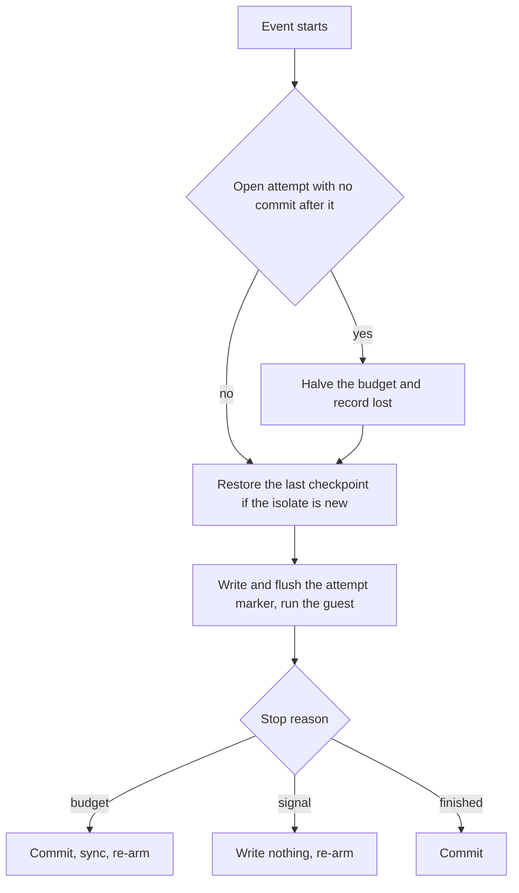

# Continuation Across Events

A Durable Object alarm event has its own CPU budget, and the platform ends an event that runs past it. This page covers the model that lets a Wasm guest stop at a clean point, keep its state and resume in a later event, and the studies that tested it.

## Question

Can a guest that needs more CPU than one event allows run to completion across events, stay exact, and lose at most the work since its last commit when the platform kills an event or moves the object?

## Instruments

| Study                                                                                                            | What it ran                                                 | Where                  |
| ---------------------------------------------------------------------------------------------------------------- | ----------------------------------------------------------- | ---------------------- |
| [signal](https://github.com/gmitch215/folio/blob/master/results/continuation/signal/README.md)                   | 30 events on deployed objects, reading the CPU warning      | Durable Objects        |
| [jspi-chain](https://github.com/gmitch215/folio/blob/master/results/continuation/jspi-chain/README.md)           | chains that keep a suspended JSPI stack across events       | Durable Objects        |
| [durable-chain](https://github.com/gmitch215/folio/blob/master/results/continuation/durable-chain/README.md)     | 30 burn events with durable checkpoints                     | Durable Objects        |
| [isolate-life](https://github.com/gmitch215/folio/blob/master/results/continuation/isolate-life/README.md)       | continuous CPU chains in four slice arms                    | Durable Objects        |
| [boundary-commit](https://github.com/gmitch215/folio/blob/master/results/continuation/boundary-commit/README.md) | 120,000 steps with commits at every budget stop             | Durable Objects, local |
| [deferred-chain](https://github.com/gmitch215/folio/blob/master/results/continuation/deferred-chain/README.md)   | the protocol that checkpoints only on the signal            | Durable Objects        |
| [checkpoint-cost](https://github.com/gmitch215/folio/blob/master/results/continuation/checkpoint-cost/README.md) | page hash and SHA-256 rates, 200 exact events               | Node 26                |
| [php-park](https://github.com/gmitch215/folio/blob/master/results/continuation/php-park/README.md)               | a PHP build that parks at the interpreter's interrupt check | Node 26, local object  |
| [php-poll-cost](https://github.com/gmitch215/folio/blob/master/results/continuation/php-poll-cost/README.md)     | paired cost of the park poll                                | Linux x86-64           |

The deployed PHP runs used the experiment folder [continuation-php](https://github.com/gmitch215/folio/blob/master/experiments/continuation-php/README.md) for the local arms. Their per-event records are not exported to `results/`.

## Design

A job is a deterministic Wasm guest with imports. A safe point is a place where the guest polls the signal word or calls an import. A quiescent point is a safe point where the guest's state lives entirely in linear memory, its mutable globals and a small host state record. The platform warns that an event's CPU is nearly spent by setting a u32 word in the guest's memory, whose address the guest exports as the i32 global `__instance_signal`.

The platform's CPU budget per event is `B`, the lead of the warning is `L`, the largest CPU between two polls is `P`, the CPU to stop and end an event is `c_y`, the CPU to start and resume is `c_r`, and the CPU of one checkpoint is `C_k`. The studies do not measure `L`, so every claim that depends on it is conditional.

Each event runs the following sequence. The diagram has the same facts as this paragraph: an event first checks for a killed attempt, restores the last checkpoint if its isolate is new, flushes an attempt marker, runs the guest, and then commits and re-arms at a budget stop, writes nothing and re-arms at a signal stop, or commits at the end.



## The Claims

Claims C1 to C9 cover planned stops. Boundaries B1 to B9 in the report cover what no design removes.

| Claim | Statement                                                                                                                                                                                                 | Evidence                                                                                  |
| ----- | --------------------------------------------------------------------------------------------------------------------------------------------------------------------------------------------------------- | ----------------------------------------------------------------------------------------- |
| C1    | A guest that stops only at a safe point and resumes in a later event of the same isolate, with memory, globals and table untouched, matches an uninterrupted run apart from the timing of import results. | Proof by determinism; 200 local events, value and memory SHA-256 equal the reference      |
| C2    | If `P + c_y < L`, no event exceeds `B`.                                                                                                                                                                   | Conditional: `L` is not measured, and 10 of 30 signal-study events reset before returning |
| C3    | Total CPU is unbounded: each event ends below `B` and hands the job to the next.                                                                                                                          | Induction on C2                                                                           |
| C4    | The guest runs at native speed plus the polls and the handoff of each event.                                                                                                                              | PHP poll cost below                                                                       |
| C5    | A durable checkpoint is exact: a restore returns the bytes of the last committed checkpoint, or it is refused.                                                                                            | Page hashes checked before any page is written; `CheckpointError` code `hash`             |
| C6    | Checkpoint cost scales with the change, plus a hash pass over the whole memory.                                                                                                                           | Deployed: 7.3 ms, 23.7 ms and 78 ms for 0, 4 MiB and 16 MiB changed                       |
| C7    | Young's first-order interval `sqrt(2 C_k M_f)` checks the commit default.                                                                                                                                 | `M_f` bounded below at 261.2 s, never estimated                                           |
| C8    | Pure compute replays for free, a write to the object's own SQLite happens exactly once, and an external effect happens at least once.                                                                     | Stated from the design; no study measures it                                              |
| C9    | If isolate moves land only between events and every budget stop commits, a move loses no work.                                                                                                            | Boundary-commit study                                                                     |

With `J` the CPU of the whole job, `N` the number of events, `T_native` the native time and `π` the share of guest time spent in polls, C3 and C4 give:

```math
N = \left\lceil \frac{J}{B - L - c_y} \right\rceil
```

```math
T = T_{\text{native}}(1 + \pi) + N(c_y + c_r)
```

With `M` bytes of memory, hash rate `H`, `D` changed bytes, write rate `W` and a fixed cost `c_0`, C6 gives:

```math
C_k = \frac{M}{H} + \frac{D}{W} + c_0
```

## Results

### The Platform Signal

| Study         | Objects and events                                                                                                       | Result                                                                                                             |
| ------------- | ------------------------------------------------------------------------------------------------------------------------ | ------------------------------------------------------------------------------------------------------------------ |
| signal        | 30 events                                                                                                                | 20 returned, with the signal fired in each; 10 reset before returning, all of them the first event of their object |
| durable-chain | 30 burn events                                                                                                           | none reset before returning; all 30 stopped on the signal at 29.998 s to 32.476 s of CPU                           |
| jspi-chain    | four chains, each changed isolate                                                                                        | none finished                                                                                                      |
| isolate-life  | five objects in each of four arms (0.1 s, 1 s and 5 s slices, and 1 s slices with a 10 s pause after 3 s of isolate CPU) | five isolate changes in each arm; the summary does not give the CPU at each move                                   |

The signal probe left a slice write unawaited while the guest ran, and the durable worker awaited its bookkeeping writes first. That difference is a candidate explanation for the 10 resets. It compares two studies with different guests and different arms, and no controlled arm tests it.

### Checkpoint Cost

On a local Node 26 runtime, a Wasm page hash ran at 3.83 to 3.95 GiB/s on 32, 64 and 128 MiB, and SHA-256 at 2.25 to 2.31 GiB/s. The module's own `hashPages` is pure JavaScript. In paired runs on one machine, which is not named, it had a median of 1.26 GiB/s on 32 MiB and 1.01 GiB/s on 128 MiB, about 0.13 s of hash pass at 128 MiB. The 128 MiB runs split, three at 1.01 to 1.32 GiB/s and two near 0.25 GiB/s, and the cause is not measured ([checkpoint-cost](https://github.com/gmitch215/folio/blob/master/results/continuation/checkpoint-cost/README.md)).

### Boundary Commits

The boundary-commit study ran 120,000 steps on three deployed objects and 30,000 on one local object. The local run had a simulated signal at step 5,000 and a cut in the commit of event 6. Each of the three deployed moves followed a commit and lost 0 steps. Final value and memory SHA-256 matched the reference in 3 of 3 deployed objects and 1 of 1 local object. The driver stored those matches as booleans, so the study records whether each object matched and not the values. No move followed a signal stop, so C9 is not tested at that boundary.

The deferred protocol checkpoints only on the isolate that holds the state and stops each event on the signal. It lost work at its moves: seven moves followed a signal-ended event, and each lost the whole slice since the last commit, between 33,831 and 36,456 steps. The deferred chain bounds the mean CPU between moves, `M_f`, from below at 261.2 s, and the move rate from above at 3.83e-3 per CPU-s at 95%.

Under C9 each event pays one commit and one handoff, and a move after a signal stop loses the signal-first event. With these inputs the model puts the cost at 1.088 to 1.149% per event for a cycle of about 18 events, and 12.83 to 12.89% for the deferred protocol, which ends every event on the signal. Because `M_f` is a lower bound, every loss term is an upper bound.

## The PHP Park

A PHP build with an interrupt-park patch places a poll at the interrupt check of the interpreter loop. A park saves the current execute data and opline and jumps back to the host. A resume re-enters the interpreter at the saved opline.

Theorem P states that an interrupt park is exact. The Zend VM keeps its frames on the heap, so a jump out of the interpreter loop keeps every live value in linear memory. Every frame on the chain must be user code, the walk must reach the host entry frame, and exactly one frame, the outermost, carries the flag the VM sets on a frame entered from C. A poll that fails this test is refused and the next admissible poll is tried. The resume replaces the host entry frames with the epilogue that the trapped-call resume already uses. A resumed interpreter then runs the same instruction sequence as a run that never parked.

A refused stretch delays the park to the next admissible poll. The interpreter retries at every poll. A fixed period aliases with a loop whose iteration holds a number of polls that divides the period, so such a loop would never reach an admissible poll.

| Arm                      | Events | Budget parks | Signal parks | Restores | Cuts | Refusals counted |
| ------------------------ | ------ | ------------ | ------------ | -------- | ---- | ---------------- |
| P1, in memory            | 49     | 46           | 2            | 4        | 0    | 77,860,147       |
| P2, local Durable Object | 50     | 47           | 2            | 4        | 1    | 71,195,287       |

The workload has two refused regions, an `array_map` with a closure and a generator loop. The stack check passed in every event. In the generator loop the first admissible poll is the consumer's `foreach` iteration, and the park landed there at event 42 in both arms, after 26 refusals. P1's and P2's output has the same SHA-256 as the uninterrupted run.

The poll costs two loads, one store and one branch. Its paired cost against a build whose poll does nothing was a median ratio of 1.018 on `fib(35)` (range 1.012 to 1.079) and 1.020 on a string-array workload (1.010 to 1.036), over 22 samples per workload. For a loop of 60 million iterations the median was 1.002 (0.974 to 1.045), which does not resolve the cost ([php-poll-cost](https://github.com/gmitch215/folio/blob/master/results/continuation/php-poll-cost/README.md)).

## The Deployed PHP Runs

The same workload ran on paid Durable Objects with a PHP guest of 96 to 115 MiB. The first deployed runs found three faults the local runs could not. The budget reset to its start at every restore, because the manifest was written before the post-commit update. A checkpoint that copied the whole memory twice put an event over the memory limit at its sixth event, which streaming one page group at a time fixed. A doubled budget of 320 million polls overran the CPU limit before any park, and each retry restored the same budget, so the object never advanced.

The fix is loss detection. An awaited write before `run()` stores the event number and budget. An event that finds an attempt for the same number with no commit after it knows the previous attempt died, halves the budget and records a `lost` event. The marker needs `storage.sync()` after the write: without the flush a killed invocation discarded it and the rule never fired.

| Run            | Objects | Outcome                                                                                                                                                                                |
| -------------- | ------- | -------------------------------------------------------------------------------------------------------------------------------------------------------------------------------------- |
| Fourth attempt | 1       | same output SHA-256 as the uninterrupted local run (`865230fb`), one exact restore, no `exceededMemory`, one alarm kill paired with one `lost` record, budget 320 to 160 million polls |
| Second run     | 3       | all three finished with the same output SHA-256, one exact restore each, one alarm kill paired with one `lost` record each, an identical budget trace                                  |

Object b changed isolate once, at its restore, and objects a and c stayed in one. No object took a signal park, so the signal path at a deployed budget was not exercised.

## Reading

Planned continuation is exact in the tested cases, and a durable checkpoint is exact by construction and by test. The deployed PHP guest recovered from one kill per object using the loss rule. The bound on lost work under boundary commits is one event's budget. The design does not prove that no event exceeds its CPU budget, because that depends on the warning's lead time.

## Closed and Open

Not shown: recovery from repeated kills, a signal park at a deployed budget, an unplanned move that follows a signal stop under C9, and the cost of a deploy that resets a running object mid-event, which loses at most one event's budget. A refused stretch longer than one event's CPU does not complete under this design, and its replay is stated from the design and not measured. The tail CPU sum exceeds the platform's GraphQL CPU figure by a wide margin in every deployed run, and the cause is not resolved. The generic C guest's poll cost has no study.

## See Also

- Report: [Claims](../../TECHNICAL_REPORT.md#claims), [PHP Park](../../TECHNICAL_REPORT.md#php-park), [Boundaries](../../TECHNICAL_REPORT.md#boundaries)
- Module: [Continuation](../modules/continuation.md)
- Related study: [Storage Resets](storage-resets.md) for the alarm shapes that decide whether an event boundary resets
